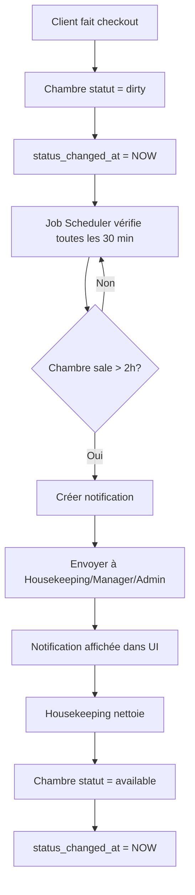

# 🚨 SYSTÈME D'ALERTE CHAMBRES SALES > 2 HEURES

---

## 📋 OBJECTIF

Créer un système d'alerte automatique qui signale lorsqu'une chambre sale n'a pas été marquée disponible après 2 heures.

---

## ✅ FONCTIONNALITÉS IMPLÉMENTÉES

### 1. **Base de Données** ✅

#### Nouvelle Colonne
- `status_changed_at` ajoutée à la table `rooms`
- Enregistre automatiquement l'heure du changement de statut

#### Trigger Automatique
```sql
CREATE TRIGGER trigger_update_room_status_timestamp
```
- Se déclenche à chaque UPDATE du statut d'une chambre
- Met à jour `status_changed_at` automatiquement

#### Vue SQL
```sql
CREATE VIEW dirty_rooms_overdue
```
- Liste toutes les chambres sales depuis > 1.5 heures
- Niveaux d'alerte: WARNING (> 1.5h), URGENT (> 2h)

#### Fonctions SQL
1. `get_overdue_dirty_rooms(hours_threshold)` - Obtenir les chambres en retard
2. `send_overdue_room_alerts()` - Envoyer des notifications automatiques

### 2. **Backend - Job Automatique** ✅

#### Scheduler (toutes les 30 minutes)
Fichier: `zen_backend/src/services/scheduledJobs.ts`

```typescript
export const startOverdueRoomsAlert = () => {
  cron.schedule('*/30 * * * *', async () => {
    // Vérifie les chambres sales > 2 heures
    // Envoie des notifications automatiques
  });
};
```

**Comportement:**
- ⏰ S'exécute toutes les 30 minutes
- 🔍 Détecte les chambres sales depuis > 2 heures
- 📬 Envoie des notifications aux:
  - Housekeeping
  - Manager
  - Admin
- 📊 Niveau de priorité:
  - `medium` pour 2-3 heures
  - `high` pour > 3 heures

### 3. **API Endpoints** ✅

Fichier: `zen_backend/src/routes/roomAlertRoutes.ts`

#### GET `/api/room-alerts/overdue?hours=2`
Obtenir toutes les chambres en retard

**Réponse:**
```json
{
  "count": 2,
  "threshold_hours": 2.0,
  "rooms": [
    {
      "id": "uuid",
      "room_number": "101",
      "room_type": "Standard",
      "floor": 1,
      "status": "dirty",
      "status_changed_at": "2026-10-30T10:00:00Z",
      "hours_overdue": 2.5,
      "alert_level": "URGENT"
    }
  ]
}
```

#### GET `/api/room-alerts/:roomId/status-duration`
Obtenir la durée du statut actuel d'une chambre

**Réponse:**
```json
{
  "id": "uuid",
  "room_number": "101",
  "room_type": "Standard",
  "status": "dirty",
  "status_changed_at": "2026-10-30T10:00:00Z",
  "hours_in_current_status": 2.5,
  "minutes_in_current_status": 150
}
```

#### GET `/api/room-alerts/stats/cleaning`
Obtenir des statistiques sur les temps de nettoyage

**Réponse:**
```json
{
  "dirty_rooms": 5,
  "cleaning_rooms": 2,
  "overdue_rooms": 2,
  "warning_rooms": 1,
  "avg_hours_dirty": 1.8,
  "max_hours_dirty": 3.2
}
```

#### POST `/api/room-alerts/trigger-alerts`
Déclencher manuellement les alertes (pour admin/manager)

**Réponse:**
```json
{
  "success": true,
  "notifications_sent": 6,
  "rooms_alerted": 2
}
```

---

## 🔐 PERMISSIONS

### Endpoints Accessibles par:
- **Admin**: Tous les endpoints
- **Manager**: Tous les endpoints
- **Housekeeping**: GET endpoints seulement

---

## 📊 NIVEAUX D'ALERTE

| Durée | Niveau | Priorité | Couleur UI |
|-------|--------|----------|-----------|
| < 1.5h | NORMAL | - | Gris |
| 1.5h - 2h | WARNING | medium | Jaune |
| > 2h | URGENT | medium/high | Rouge |
| > 3h | URGENT | high | Rouge foncé |

---

## 🚀 DÉPLOIEMENT

### 1. Exécuter le script SQL
```sql
-- Dans Supabase SQL Editor
-- Coller le contenu de: database/ADD_ROOM_CLEANING_ALERT_SYSTEM.sql
```

### 2. Commit et Push Backend
```bash
cd zen_backend
git add .
git commit -m "feat: Add room cleaning alert system (auto-alert after 2 hours)"
git push origin main
```

### 3. Redémarrage Automatique
- Render redémarre automatiquement en 3-5 minutes
- Le job scheduler démarre avec le serveur
- Premières alertes dans max 30 minutes

---

## 🧪 TESTS

### Test 1: Simuler une chambre sale depuis 3 heures
```sql
UPDATE rooms 
SET status = 'dirty', 
    status_changed_at = NOW() - INTERVAL '3 hours'
WHERE room_number = '101';
```

### Test 2: Vérifier les chambres en retard
```sql
SELECT * FROM dirty_rooms_overdue;
```

### Test 3: Tester la fonction d'alerte
```sql
SELECT * FROM get_overdue_dirty_rooms(2.0);
```

### Test 4: Envoyer des alertes manuellement
```sql
SELECT * FROM send_overdue_room_alerts();
```

### Test 5: Via API
```bash
# GET overdue rooms
curl -X GET "https://zen-backend-jzjh.onrender.com/api/room-alerts/overdue?hours=2" \
  -H "Authorization: Bearer YOUR_TOKEN"

# Trigger alerts manually
curl -X POST "https://zen-backend-jzjh.onrender.com/api/room-alerts/trigger-alerts" \
  -H "Authorization: Bearer YOUR_TOKEN"
```

---

## 📱 NOTIFICATIONS ENVOYÉES

### Exemple de Notification

**Titre:** 🚨 Chambre 101 - Nettoyage en retard

**Message:** La chambre 101 (Standard) est sale depuis 2.5 heures. Veuillez la traiter immédiatement.

**Priorité:** medium (2-3h) ou high (>3h)

**Destinataires:**
- Tous les utilisateurs avec rôle `housekeeping`
- Tous les utilisateurs avec rôle `manager`
- Tous les utilisateurs avec rôle `admin`

---

## 🔄 WORKFLOW COMPLET



---

## 💡 AMÉLIORATIONS FUTURES

### Optionnel
1. **Email Alert** - Envoyer aussi un email pour les chambres > 3h
2. **SMS Alert** - SMS pour urgences (> 4h)
3. **Tableau de Bord** - Widget dédié aux chambres en retard
4. **Historique** - Tracer l'historique des temps de nettoyage
5. **Rapports** - Rapport hebdomadaire des performances de nettoyage
6. **Escalation** - Alert manager si > 3h, directeur si > 4h

---

## 📝 FICHIERS MODIFIÉS/CRÉÉS

### Base de Données
- ✅ `database/ADD_ROOM_CLEANING_ALERT_SYSTEM.sql` (nouveau)

### Backend
- ✅ `zen_backend/src/services/scheduledJobs.ts` (modifié)
- ✅ `zen_backend/src/controllers/roomAlertController.ts` (nouveau)
- ✅ `zen_backend/src/routes/roomAlertRoutes.ts` (nouveau)
- ✅ `zen_backend/src/routes/index.ts` (modifié)

### Documentation
- ✅ `SYSTEME_ALERTE_CHAMBRES_SALES.md` (nouveau)

---

## ✅ CHECKLIST DE DÉPLOIEMENT

- [ ] Exécuter le script SQL dans Supabase
- [ ] Commit et push backend vers GitHub
- [ ] Attendre le redémarrage Render (3-5 min)
- [ ] Tester avec une chambre simulée
- [ ] Vérifier les notifications dans l'UI
- [ ] Documenter pour l'équipe

---

## 📞 SUPPORT

En cas de problème:
1. Vérifier les logs Render: https://dashboard.render.com
2. Vérifier la console SQL Supabase
3. Tester les endpoints API manuellement
4. Vérifier que le job scheduler démarre (logs backend)

---

**Créé le:** 30 octobre 2026  
**Statut:** PRÊT À DÉPLOYER 🚀  
**Priorité:** HAUTE - Impacte l'efficacité opérationnelle
